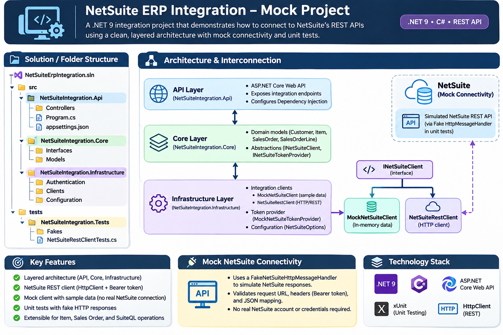

# NetSuite ERP Integration

A .NET 9 project demonstrating how to integrate an external ERP system (NetSuite) using REST APIs and a clean, layered architecture.

Currently, this project follows a **mock-first development approach**, allowing integration functionality to be developed and tested without requiring an actual NetSuite account.

## Project Architecture

## Solution Structure

- **NetSuiteIntegration.Api** – ASP.NET Core Web API and application entry point.
- **NetSuiteIntegration.Core** – Domain models and interfaces.
- **NetSuiteIntegration.Infrastructure** – NetSuite REST client, mock client, authentication, and configuration.
- **NetSuiteIntegration.Tests** – Unit tests for integration functionality.

## Key Features

- Layered architecture (API, Core, Infrastructure).
- Mock NetSuite connectivity using sample data.
- NetSuite REST API client using HttpClient.
- Bearer token authentication structure.
- JSON response mapping.
- Unit testing with xUnit and simulated HTTP responses.
- Extensible design for Customers, Items, Sales Orders, and SuiteQL operations.

## Technology Stack

- .NET 9
- C#
- ASP.NET Core Web API
- HttpClient
- REST API
- JSON
- xUnit

## Development Status

This project is under active development.

The current implementation supports mock connectivity and customer retrieval through the REST client. Additional NetSuite operations will be implemented incrementally.

**Note:** No real NetSuite account or credentials are currently required.
